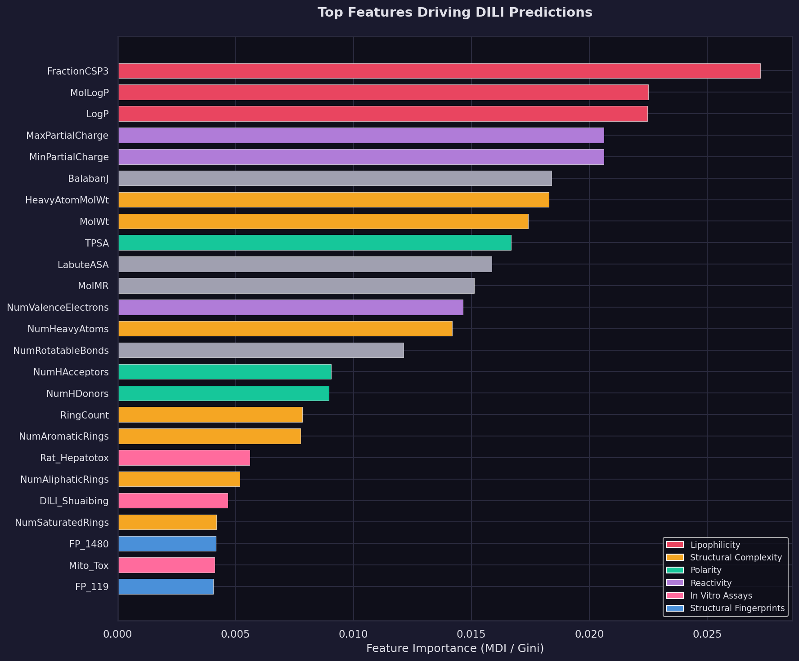
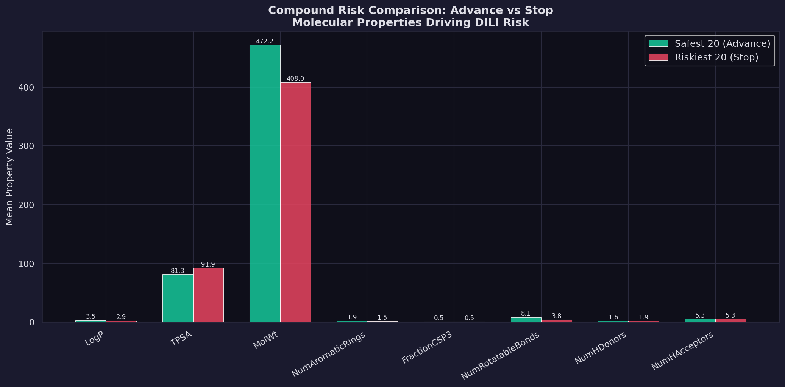

# DILI Toxicity Predictor

Multi-modal machine learning pipeline for predicting **Drug-Induced Liver Injury (DILI)** from chemical structure, in vitro assay data, and pharmacokinetic parameters. DILI is responsible for ~20-25% of clinical trial failures and is the leading cause of post-market drug withdrawals.

## Visualizations

### Model Performance Comparison
<p align="center"></p>

### ROC & Precision-Recall Curves
<p align="center"></p>

### Mechanistic Radar — DILI Risk Factor Decomposition
<p align="center"></p>

### Top Features Driving Hepatotoxicity Predictions
<p align="center"></p>

### Compound Risk Comparison (Advance vs Stop)
<p align="center"></p>

### Chemical Space — Toxicity Landscape (t-SNE)
<p align="center"></p>

### Calibration & Probability Distribution
<p align="center"></p>

## Data Sources

All data is from peer-reviewed, publicly available sources — no synthetic or mock data:

| Dataset | Source | Compounds | Description |
|---------|--------|-----------|-------------|
| **DILIst Gold Standard** | [FDA LTKB](https://www.fda.gov/science-research/liver-toxicity-knowledge-base-ltkb) / [Seal et al. 2024](https://github.com/srijitseal/DILI) | 1,111 | Binary DILI classification of FDA-approved drugs |
| **Proxy-DILI Labels** | Seal et al. 2024 | 13,703 | Mitochondrial toxicity, BSEP inhibition, rat hepatotoxicity |
| **Cmax Pharmacokinetics** | Seal et al. 2024 | 727 | Clinical plasma concentration (total and unbound) |

## Models

Eight model configurations trained and compared, including transfer learning experiments:

| Model | Architecture | AUC-ROC | AUC-PR | Sensitivity | Specificity | MCC |
|-------|-------------|---------|--------|-------------|-------------|-----|
| NeuralNet | Multi-modal feed-forward (FP + descriptors + assays) | **0.693** | 0.764 | 0.599 | 0.744 | **0.328** |
| Random Forest | 500 trees on Morgan FP + descriptors + assays | 0.675 | 0.767 | 0.838 | 0.359 | 0.223 |
| GNN | Graph Convolutional Network on molecular graphs | 0.671 | **0.800** | 0.599 | 0.603 | 0.193 |
| HepaTox-Fusion | Multi-task GIN + highway FP + cross-attention *(novel)* | 0.662 | 0.747 | 0.683 | 0.564 | 0.241 |
| GNN-PreTrained | GCN pre-trained on 8K proxy-DILI → fine-tuned | 0.658 | 0.771 | 0.599 | 0.628 | 0.217 |
| Fusion-PreTrained | HepaTox-Fusion pre-trained → fine-tuned | 0.629 | 0.746 | 0.669 | 0.462 | 0.129 |
| XGBoost | Gradient-boosted trees | 0.618 | 0.748 | 0.718 | 0.449 | 0.169 |
| SVM | RBF kernel with balanced classes | 0.611 | 0.733 | 0.951 | 0.154 | 0.178 |

## Transfer Learning Experiment

A key experiment in this project tested whether **pre-training on ~8,500 proxy-DILI compounds** (from mitochondrial toxicity, BSEP inhibition, and rat hepatotoxicity assays) could improve the complex models when fine-tuned on the 1,111-compound DILIst gold standard.

**Approach:**
1. **Multi-task pre-training**: GNN and HepaTox-Fusion trained on the full proxy-DILI dataset with separate task heads for each assay source (val AUC: 0.76 GNN, 0.74 Fusion)
2. **Staged fine-tuning**: Head warmup with frozen backbone → full fine-tuning with discriminative learning rates and early stopping

**Result: Negative transfer.** Pre-trained models performed slightly *worse* than their from-scratch counterparts (GNN: 0.658 vs 0.671; Fusion: 0.629 vs 0.662). This is a well-known challenge in drug toxicity prediction:

- **Task misalignment**: Proxy endpoints (rat hepatotoxicity, BSEP) capture different mechanisms than human DILI, introducing bias into the learned representations
- **Distribution shift**: The chemical space of proxy-tested compounds differs from FDA-approved drugs in DILIst
- **Label noise**: Proxy labels aggregate heterogeneous assays with variable reliability

This negative result is scientifically informative — it demonstrates that more data alone doesn't improve DILI prediction; the data must be mechanistically aligned with the target endpoint. Future work could explore self-supervised pre-training on molecular structure (contrastive learning on unlabeled compounds) rather than supervised pre-training on weakly related endpoints.

## HepaTox-Fusion Architecture

A **Multi-Task Attentive Fusion Network** inspired by recent research:

- [DeepGPT-DILI (2025)](https://hub.tmu.edu.tw/en/publications/deepgpt-dili-integrating-graph-convolutional-networks-andlarge-la/): Ensemble of GCN + fingerprints + LLM embeddings
- [DILIGeNN (2025)](https://link.springer.com/article/10.1186/s13321-025-01068-3): GNN with augmented graph features
- [Multi-task toxicity learning (2025)](https://pmc.ncbi.nlm.nih.gov/articles/PMC12912713/): Shared representations across correlated endpoints

```
SMILES ──► GIN (4-layer Graph Isomorphism Network) ──► graph_emb (128d)
       ──► Highway FP (3-layer gated network on Morgan FP) ──► fp_emb (256d)
       ──► Cross-Attention (FP queries attend to GIN nodes) ──► fused (256d)
       ──► Descriptor Branch (physicochemical props) ──► desc_emb (32d)
                          │
                ┌─────────┴─────────┐
                │  Shared Trunk     │
                ├───────────────────┤
                │ Primary: DILI     │
                │ Aux: Mito Tox     │
                │ Aux: BSEP         │
                │ Aux: Rat Hepato   │
                │ Aux: ...          │
                └───────────────────┘
```

**Key ideas:** Cross-attention between FP embeddings and graph node embeddings identifies which substructures drive toxicity. Multi-task learning with proxy-DILI auxiliary objectives regularizes training on the small 1,111-compound dataset.

## Features

### Molecular Featurization
- **Morgan fingerprints** (2048-bit, radius 2)
- **20 physicochemical descriptors**: MolWt, LogP, TPSA, HBD/HBA, aromatic rings, FractionCSP3, partial charges, etc.
- **5 Lipinski Rule-of-5 alerts**
- **Graph representation**: Atom features (139-dim) + bond features (7-dim)

### Proxy-DILI Assay Labels
- Mitochondrial toxicity, BSEP inhibition, rat hepatotoxicity, and other proxy endpoints merged from 13,703 compounds

### Mechanistic Interpretability
Feature importance decomposed into hepatotoxicity mechanisms: lipophilicity (steatosis), structural complexity (reactive metabolites), polarity (cholestasis), reactivity (ER stress/ROS), and in vitro assay signals.

## Project Structure

```
dili-tox-predictor/
├── train.py                        # Full training pipeline
├── data/
│   ├── download.py                 # Auto-downloads real datasets
│   └── *.csv                       # Downloaded on first run
├── src/
│   ├── data_loading.py             # Data merging and preprocessing
│   ├── featurization.py            # Molecular featurization
│   ├── evaluation.py               # Metrics and model comparison
│   ├── pretrain.py                 # Pre-train → fine-tune pipeline
│   ├── interpret.py                # Feature importance analysis
│   ├── visualize.py                # Publication-quality plots
│   └── models/
│       ├── classical.py            # Random Forest, XGBoost, SVM
│       ├── neural.py               # Feed-forward neural network
│       ├── gnn.py                  # Graph Convolutional Network
│       └── hybrid.py               # HepaTox-Fusion
└── outputs/                        # Generated results and plots
```

## Quick Start

```bash
cd dili-tox-predictor
python train.py
```

Datasets are automatically downloaded on first run. The full pipeline trains 8 model configurations (including transfer learning experiments) and generates all visualizations.

## References

- Seal, S. et al. (2024). *Enhancing Early Detection of Drug-Induced Liver Injury*. [GitHub](https://github.com/srijitseal/DILI)
- Chen, M. et al. (2016). *DILIrank: the largest reference drug list ranked by DILI risk*. Drug Discovery Today.
- Thakkar, S. et al. (2020). *DILIst: binary classification of 1279 drugs*. Drug Discovery Today.
- DeepGPT-DILI (2025). *Integrating GCN and LLM Embeddings for DILI Prediction*.
- DILIGeNN (2025). *GNNs with augmented graph features*. J. Cheminformatics.
- HTP-Pred (2025). *GNN-based hepatotoxicity prediction*. J. Cheminformatics.
