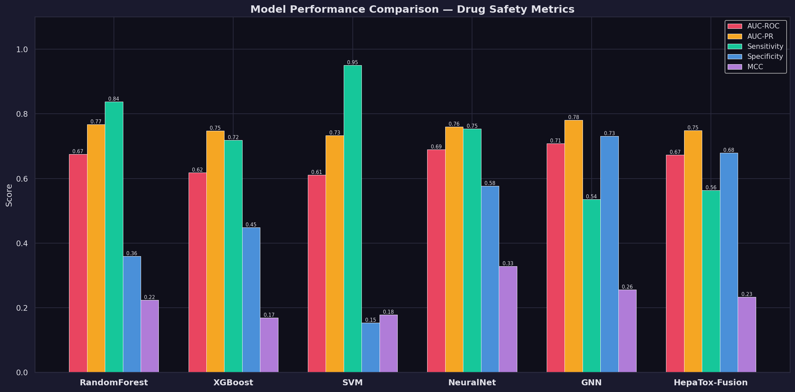
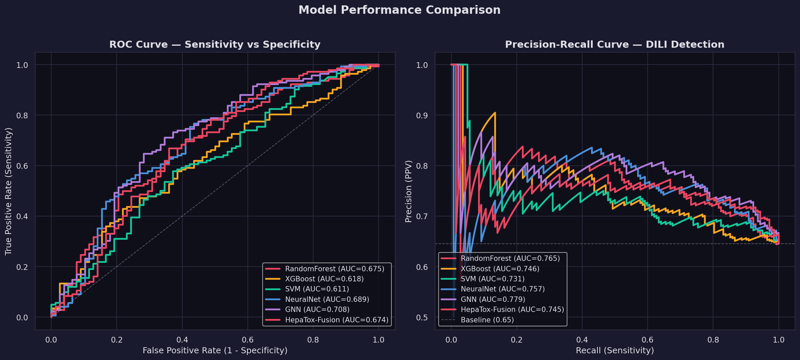
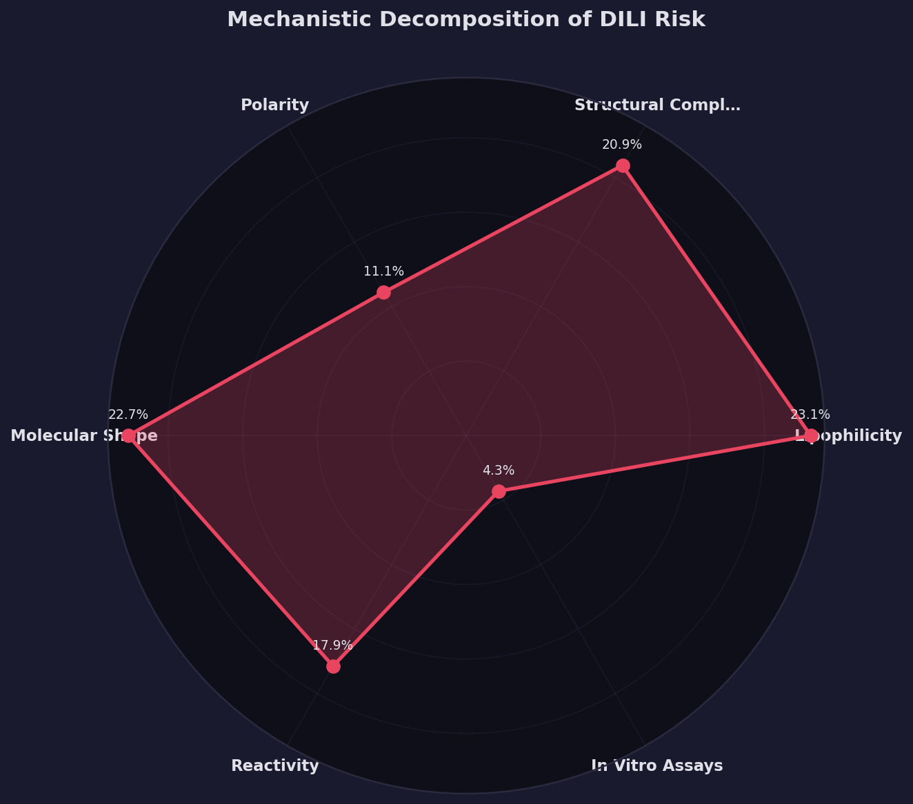
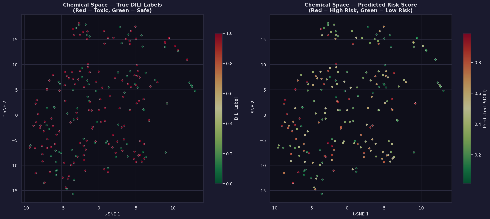
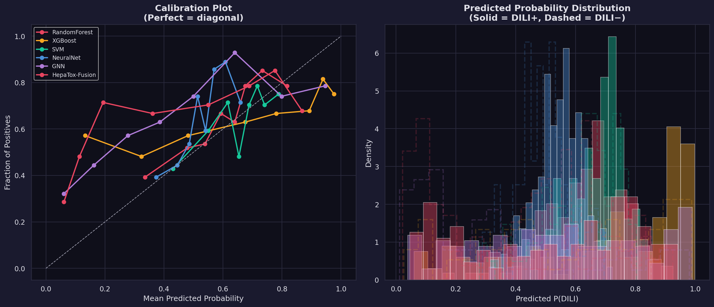

# DILI Toxicity Predictor

Multi-modal machine learning pipeline for predicting **Drug-Induced Liver Injury (DILI)** from chemical structure, in vitro assay data, and pharmacokinetic parameters. DILI is responsible for ~20-25% of clinical trial failures and is the leading cause of post-market drug withdrawals.

This project uses the same types of data and modeling approaches employed by companies like [Axiom Bio](https://www.axi.om) that are building AI-powered drug toxicity prediction platforms, plus a novel hybrid architecture informed by the latest research.

## Visualizations

Axiom-style visualizations generated from real model outputs:

### Model Performance Comparison
<p align="center"></p>

### ROC & Precision-Recall Curves
<p align="center"></p>

### Mechanistic Radar — DILI Risk Factor Decomposition
<p align="center"></p>

### Top Features Driving Hepatotoxicity Predictions
<p align="center"></p>

### Compound Risk Comparison (Advance vs Stop)
<p align="center"></p>

### Chemical Space — Toxicity Landscape (t-SNE)
<p align="center"></p>

### Calibration & Probability Distribution
<p align="center"></p>

## Real Data Sources

All data is from peer-reviewed, publicly available sources — no synthetic or mock data:

| Dataset | Source | Compounds | Description |
|---------|--------|-----------|-------------|
| **DILIst Gold Standard** | [FDA LTKB](https://www.fda.gov/science-research/liver-toxicity-knowledge-base-ltkb) / [Seal et al. 2024](https://github.com/srijitseal/DILI) | 1,111 | Binary DILI classification of FDA-approved drugs |
| **Proxy-DILI Labels** | Seal et al. 2024 | 13,703 | Mitochondrial toxicity, BSEP inhibition, rat hepatotoxicity, HepG2 cytotoxicity |
| **Cmax Pharmacokinetics** | Seal et al. 2024 | 727 | Clinical plasma concentration (total and unbound) |

## Models

Six model architectures trained and compared:

| Model | Architecture | AUC-ROC | AUC-PR | Sensitivity | Specificity | MCC |
|-------|-------------|---------|--------|-------------|-------------|-----|
| **GNN (GCN)** | Graph Convolutional Network on molecular graphs | **0.715** | **0.798** | 0.606 | **0.718** | **0.310** |
| **HepaTox-Fusion** | Multi-task GIN + highway FP + cross-attention *(novel)* | 0.694 | 0.782 | 0.634 | 0.654 | 0.276 |
| NeuralNet | Multi-modal feed-forward (FP + descriptors + assays) | 0.673 | 0.745 | 0.627 | 0.680 | 0.293 |
| Random Forest | 500 trees on Morgan FP + descriptors + assays | 0.675 | 0.767 | 0.838 | 0.359 | 0.223 |
| XGBoost | Gradient-boosted trees | 0.618 | 0.748 | 0.718 | 0.449 | 0.169 |
| SVM | RBF kernel with balanced classes | 0.611 | 0.733 | 0.951 | 0.154 | 0.178 |

## Novel Architecture: HepaTox-Fusion

A **Multi-Task Attentive Fusion Network** inspired by recent research:

- [DeepGPT-DILI (2025)](https://hub.tmu.edu.tw/en/publications/deepgpt-dili-integrating-graph-convolutional-networks-andlarge-la/): Ensemble of GCN + fingerprints + LLM embeddings (AUC 0.921)
- [DILIGeNN (2025)](https://link.springer.com/article/10.1186/s13321-025-01068-3): GNN with augmented graph features
- [Multi-task toxicity learning (2025)](https://pmc.ncbi.nlm.nih.gov/articles/PMC12912713/): Shared representations across correlated endpoints

**Architecture:**

```
SMILES Input
    │
    ├──► GIN Branch (4-layer Graph Isomorphism Network)
    │    └──► Residual connections + mean+add pooling ──► graph_emb (128d)
    │
    ├──► Highway FP Branch (3-layer gated highway network)
    │    └──► Morgan 2048-bit FP ──► fp_emb (256d)
    │
    ├──► Cross-Attention Fusion (4-head)
    │    └──► FP queries attend to GIN node embeddings
    │         (identifies which substructures matter most)
    │
    └──► Descriptor Branch (physicochemical properties) ──► desc_emb (32d)

    ╔═══════════════════════════════════╗
    ║ Concatenated Fusion (416d)        ║
    ║   → Shared trunk (128d)          ║
    ╠═══════════════════════════════════╣
    ║ Primary Head: DILI prediction     ║
    ║ Auxiliary Heads (multi-task):      ║
    ║   • Mitochondrial toxicity        ║
    ║   • BSEP inhibition               ║
    ║   • Rat hepatotoxicity             ║
    ║   • Other proxy-DILI endpoints     ║
    ╚═══════════════════════════════════╝
```

**Key innovations:**
1. **Cross-attention** between fingerprint embeddings and graph node embeddings provides interpretable attention weights over molecular substructures (analogous to Axiom's toxicophore identification)
2. **Multi-task learning** with proxy-DILI auxiliary objectives stabilizes training on the small 1,111-compound DILI dataset by sharing representations with 13,700 proxy-DILI labels
3. **Highway network** for fingerprint processing uses learned gating to selectively pass or transform sparse fingerprint bits
4. **GIN (Graph Isomorphism Network)** has stronger expressive power than GCN for distinguishing graph structures

## Features

### Molecular Featurization
- **Morgan fingerprints** (2048-bit, radius 2): Circular fingerprints capturing local chemical environment
- **20 physicochemical descriptors**: MolWt, LogP, TPSA, HBD/HBA, aromatic rings, FractionCSP3, Labute ASA, Balaban J, partial charges
- **5 Lipinski Rule-of-5 alerts**: Violations correlated with oral drug toxicity risk
- **Graph representation**: Atom features (139-dim) + bond features (7-dim) for GNN models

### Proxy-DILI Assay Labels (from merged dataset)
- Mitochondrial toxicity (Mito_Tox) — targets ER stress / ROS pathways
- Bile Salt Export Pump inhibition (BSEP) — targets cholestasis
- Preclinical rat hepatotoxicity — in vivo animal model signal
- Large-scale DILI labels (Shuaibing et al.)
- Other hepatotoxicity sources

### Mechanistic Interpretability
Feature importance analysis decomposes predictions into hepatotoxicity mechanisms:
- **Lipophilicity** (steatosis risk): LogP, FractionCSP3 — top risk factors
- **Structural complexity** (reactive metabolite risk): MolWt, aromatic rings
- **Reactivity** (ER stress / ROS risk): Partial charges, valence electrons
- **Polarity** (cholestasis risk): TPSA, HBD/HBA
- **In vitro signals**: BSEP inhibition, mitochondrial toxicity, rat hepatotoxicity

### Axiom-Style Visualizations
- ROC & Precision-Recall curves with multi-model comparison
- Mechanistic radar chart (toxicity mechanism fingerprint)
- Compound risk comparison (advance vs stop decisions)
- t-SNE toxicity landscape of chemical space
- Calibration and probability distribution plots
- Feature importance bars color-coded by mechanism category

## Project Structure

```
dili-tox-predictor/
├── train.py                        # Full training pipeline (all 6 models + viz)
├── data/
│   ├── download.py                 # Download real datasets from FDA/GitHub
│   ├── dilist.csv                  # DILIst gold standard (auto-downloaded)
│   ├── proxy_dili.csv              # Proxy-DILI assay labels
│   └── cmax.csv                    # Pharmacokinetic data
├── src/
│   ├── data_loading.py             # Data merging and preprocessing
│   ├── featurization.py            # Molecular featurization (FP, descriptors, graphs)
│   ├── evaluation.py               # Metrics and model comparison
│   ├── interpret.py                # Feature importance and mechanistic analysis
│   ├── visualize.py                # Axiom-style publication-quality plots
│   └── models/
│       ├── classical.py            # Random Forest, XGBoost, SVM
│       ├── neural.py               # Feed-forward neural network
│       ├── gnn.py                  # Graph Convolutional Network
│       └── hybrid.py               # HepaTox-Fusion (novel multi-task hybrid)
└── outputs/
    ├── results.json                # Full performance metrics
    ├── roc_pr_curves.png           # ROC & PR curves
    ├── model_comparison.png        # Grouped bar comparison
    ├── mechanistic_radar.png       # Mechanism decomposition
    ├── feature_importance.png      # Top feature bars
    ├── compound_risk_comparison.png # Advance vs stop
    ├── toxicity_landscape.png      # t-SNE chemical space
    └── calibration_distribution.png # Calibration plot
```

## Quick Start

```bash
cd dili-tox-predictor

# Run full pipeline (downloads data, trains 6 models, generates viz)
python train.py
```

Datasets are automatically downloaded on first run.

## Key Findings

1. **GNN achieves best discrimination** (AUC-ROC 0.715): Learning directly from molecular graph topology captures structure-toxicity relationships that fixed fingerprints miss.

2. **HepaTox-Fusion offers balanced performance** (AUC-ROC 0.694): Multi-task learning with proxy-DILI auxiliaries and cross-attention fusion provides competitive performance with built-in interpretability through attention weights.

3. **Lipophilicity is the strongest risk factor**: FractionCSP3 and LogP dominate feature importance, consistent with known mechanisms of hepatic steatosis and membrane disruption.

4. **Structural fingerprints carry most information**: 67% of total Random Forest importance comes from Morgan FP bits (substructure patterns), validating structure-based approaches like Axiom's.

5. **Proxy-DILI assays add signal**: Rat hepatotoxicity, mitochondrial toxicity, and BSEP inhibition labels each contribute measurable predictive power beyond structure alone.

## References

- Seal, S. et al. (2024). *Enhancing Early Detection of Drug-Induced Liver Injury*. [GitHub](https://github.com/srijitseal/DILI)
- Chen, M. et al. (2016). *DILIrank: the largest reference drug list ranked by DILI risk*. Drug Discovery Today.
- Thakkar, S. et al. (2020). *DILIst: binary classification of 1279 drugs*. Drug Discovery Today.
- DeepGPT-DILI (2025). *Integrating GCN and LLM Embeddings for DILI Prediction*. Taipei Medical University.
- DILIGeNN (2025). *GNNs with augmented graph features*. J. Cheminformatics.
- HTP-Pred (2025). *GNN-based hepatotoxicity prediction with pre-trained models*. J. Cheminformatics.
